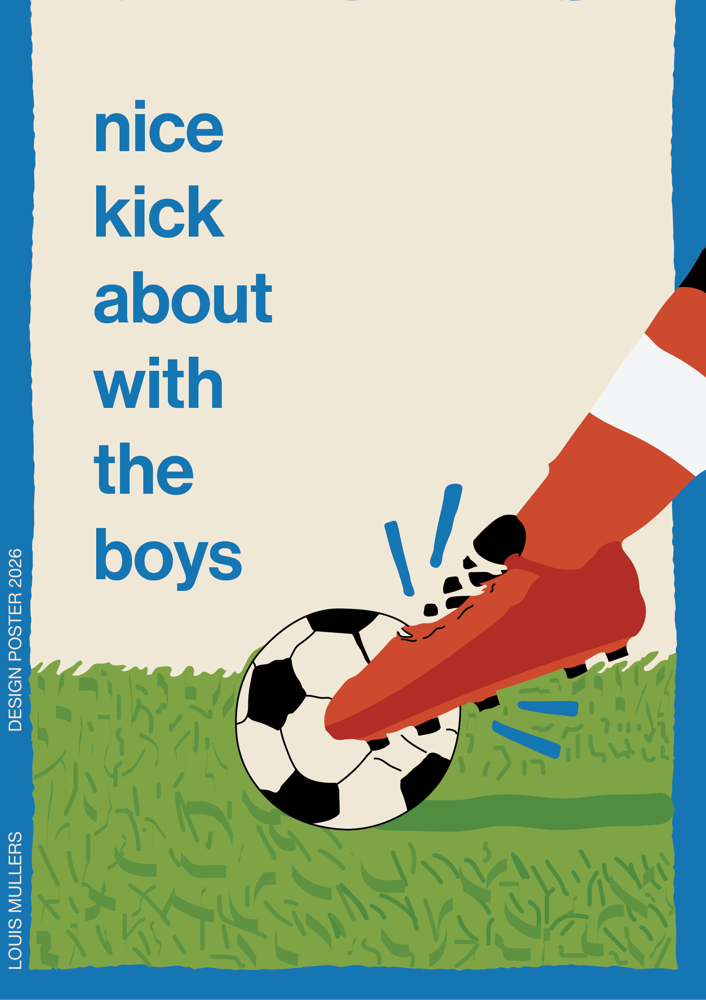

# Portfolio Site — Claude Code Workflow

## Project Context

This is a personal creative portfolio for **Louis Mullers**, Communication & Multimedia Design student at Hogeschool Zuyd. A showcase of design projects (UI/UX, branding, editorial, visual campaigns) built in vanilla HTML/CSS/JavaScript — no frameworks.

**Design philosophy:** Simple, clean, creative. Forest green (#1f4d2b) + warm cream (#f4ebd7).

**Stack:** Vanilla HTML/CSS/JS, Adobe Fonts CDN (neue-haas-grotesk), Google Fonts (Cormorant).

---

## Design System

### Color Tokens (CSS custom properties in style.css)

```css
--bg:           #f4ebd7    /* Warm cream — main background */
--fg:           #0c0c0b    /* Near-black — primary text */
--green:        #1f4d2b    /* Forest green — accent, hover states */
--green-dark:   #162419    /* Darker green — footer background */
--muted:        #7d7567    /* Warm grey — secondary text, meta info */
--border:       rgba(12,12,11,0.11) /* Subtle borders */
```

### Typography System

**Primary fonts:**
- `neue-haas-grotesk-display` — Headlines, hero, big statements (Adobe Fonts)
- `neue-haas-grotesk-text` — Body text, nav, taglines (Adobe Fonts)
- `Cormorant` — Serif italic accents, editorial moments (Google Fonts)

**Usage patterns:**
- H1/H2 (display) — always neue-haas-grotesk-display, bold or regular
- Body/nav — neue-haas-grotesk-text
- Quotes, italic highlights — Cormorant italic (footer CTA, about section, project descriptions)

**Key sizes:**
- Nav: 72px height (--nav-h)
- Hero name: clamp(72px, 15vw, 190px) — staggered left (14% margin-left indent on 2nd line)
- Body: 16px base
- Padding: clamp(28px, 4.4vw, 52px) — responsive margins

---

## Project Structure

```
Portofolio - code/
├── index.html              ← Homepage
├── about.html              ← About page
├── project.html            ← Case study 01 (Brand Identity)
├── project-02.html         ← Case study 02 (Editorial Design)
├── project-03.html         ← Case study 03 (Visual Campaign)
├── project-04.html         ← Case study 04 (Packaging Design)
├── style.css               ← All styles (1212 lines, custom CSS)
├── CLAUDE.md               ← This file
├── CONTENT_TODO.md         ← Content checklist (what Louis needs to fill in)
├── .gitignore
└── assets/
    ├── images/
    │   ├── gradient-sphere@2x.png    ← Hero decorative sphere
    │   ├── logo.svg                  ← Nav logo (SVG from Illustrator)
    │   ├── poster-1.png              ← Slideshow posters (exported from PDF)
    │   ├── poster-2.png
    │   ├── poster-3.png
    │   ├── portrait.jpg              ← [MISSING] About page portrait
    │   └── Poster-*.pdf              ← Originals (not in git, see .gitignore)
    └── files/
        └── louis-mullers-cv.pdf      ← [MISSING] CV download
```

---

## Key Components & Patterns

### Nav Bar
- Always 72px height (sticky top, cream bg)
- Logo (SVG, 36px) + ABOUT link + PROJECTS link
- Active page link is dimmed (pointer-events: none, opacity 0.5)

**Update nav across all 6 files:** Edit one, then copy the pattern to others.

### Hero Section (index.html only)
- Full height: `height: calc(100dvh - var(--nav-h))`
- Staggered name: "Louis" + "Mullers" (2nd line has 14% margin-left)
- Decorative sphere SVG (right side, top-right, partly cut off)
- Three staggered taglines with border-bottom divider line
- Tagline text styling: line 1 + 2 (normal), line 2 (Cormorant italic, larger)

### Slideshow (index.html below hero)
- 6 slides, height: 100dvh
- Auto-advance every 2000ms
- Left click (left half screen) = prev, right click (right half) = next
- Progress bar at bottom animates during 2s interval
- Counter: "01 / 06" at bottom-right

**To add/edit slides:**
```html
<div class="slide slide--1">
  
</div>
<!-- Duplicate for more slides, update slide--N class -->
```

### Works Grid (index.html below slideshow)
- 2×2 grid layout
- Each `.work-item` is a card with:
  - `.work-item-img` (gradient placeholder or real image)
  - `.work-item-link` (text link → project page)
- On hover: text turns green, overlay appears with "View project"

**Links work like this:**
- `.work-item:nth-child(1)` → `href="project.html"` (Brand Identity)
- `.work-item:nth-child(2)` → `href="project-02.html"` (Editorial Design)
- `.work-item:nth-child(3)` → `href="project-03.html"` (Visual Campaign)
- `.work-item:nth-child(4)` → `href="project-04.html"` (Packaging Design)

### Footer (all 6 pages)
- Green background (--green-dark, #162419)
- Large CTA: "Get in touch ↗" button (wipe-fill animation on hover)
  - Opens Gmail compose: `mailto:mullerslouis2@gmail.com`
- Pulsing green dot + "Available for work"
- Cream-colored base bar: © 2026 + Download CV + LinkedIn + Instagram

**Social links:**
- LinkedIn: `https://nl.linkedin.com/in/louis-mullers-193283380`
- Instagram: `https://www.instagram.com/louis_mullers/`
- CV download: downloads from `assets/files/louis-mullers-cv.pdf` (must exist)

### Project Pages (project.html, project-02.html, etc.)

**Structure:**
1. Nav (same as all pages)
2. Hero eyebrow — "01 Branding · 2024" (small metadata)
3. Title — staggered (e.g., "Brand / Identity"), border lines above & below
4. Meta row — Year, Role, Type, Tools
5. Hero image — full-width 16:9 or custom ratio
6. Overview — 2-column: left has descriptive text, right has deliverables list
7. Galleries — various layouts (duo, trio, 2×2, full-bleed)
8. Next project section — large staggered text + link to next project (loops 04→01)

**Gallery layout classes in CSS:**
- `.project-gallery-duo` — 2 items (left 3:4 portrait, right 2 landscape stacked)
- `.project-gallery-trio` — 3 columns (e.g., poster triptych)
- `.project-gallery-grid` — 2×2 grid of squares

**To add project images:**
Replace gradient `.pimg` divs with:
```html

```

### About Page (about.html)

**Sections:**
1. Hero — Name (staggered) + portrait (3:4)
2. Bio — Large Cormorant italic quote + 2 paragraphs of body text
3. Details grid — 4 cells: Based in · Education · Status (pulsing dot) · Contact (email link)
4. Skills — 2-column:
   - Left: "How I think" (soft skills: problem-solving, storytelling, etc.)
   - Right: "How I work" (technical tools with proficiency bars)
5. Footer (same as all pages)

**Skills proficiency:**
- Illustrator: 90% (Fluent)
- Figma: 86% (Fluent)
- InDesign: 62% (Proficient)
- Photoshop: 58% (Proficient)
- Blender: 44% (Learning)

---

## Style.css Structure

**1212 lines total, organized by sections:**

- Lines 1–50: Root tokens + imports (Adobe Fonts, Google Fonts)
- Lines 50–85: Reset + base typography
- Lines 85–160: Navigation bar
- Lines 160–300: Hero (name, sphere, taglines)
- Lines 300–430: Slideshow (track, slides, counters, progress)
- Lines 430–600: Works grid + footer
- Lines 600–1000: Project page layouts (galleries, next-project section)
- Lines 1000–1212: About page + skills section

**Important:** CSS is fully custom, no Tailwind. All responsive sizing uses `clamp()` for fluid scaling.

---

## Rules for Louis (Important!)

### Content Must Be Authentic
✅ **Do:**
- Fill in your own bio, project descriptions, quotes
- Use your real project names and dates
- Write skill descriptions in your own words
- Keep text natural and conversational

❌ **Don't:**
- Leave placeholder text in final version
- Use AI-sounding language (corporate, generic, overly formal)
- Copy project descriptions from other portfolios
- The docent must see YOU made it — not an AI

### Design Changes
- Keep the color palette (cream + green)
- Keep neue-haas-grotesk + Cormorant pairing
- Mobile-first responsive design (not yet implemented — use Haiku model for quick fixes)
- When in doubt: simplify, don't add unnecessary elements

### Technical Notes
- No build tools, no npm scripts — pure HTML/CSS/JS
- Run via VS Code Live Server (right-click index.html → Open with Live Server)
- Check console for errors: Ctrl+Shift+J (or F12 → Console)
- Test on mobile: Chrome DevTools → toggle device toolbar

---

## What's Missing (Must be Done)

See **CONTENT_TODO.md** for the full checklist. In short:

- [ ] Portrait photo → `assets/images/portrait.jpg`
- [ ] CV PDF → `assets/files/louis-mullers-cv.pdf`
- [ ] About page: quote + bio text (your own words)
- [ ] Project pages: real titles, descriptions, images
- [ ] Project 01 (project.html) title: currently "projectnaam"

---

## How to Work in VS Code

1. **Open folder:** File → Open Folder → choose `Portofolio - code`
2. **Use Claude extension:**
   - Click the Claude icon in the sidebar
   - This file (CLAUDE.md) will be auto-loaded as context
   - You can ask Claude for help on any page, and it will understand the full design system
3. **Live preview:**
   - Right-click `index.html` → Open with Live Server
   - Browser opens on `http://localhost:5500`
   - Changes auto-refresh
4. **Check mobile:** Chrome DevTools → toggle device toolbar (Ctrl+Shift+M)

---

## Next Steps After Content Setup

Once CONTENT_TODO.md is completed:

1. **Mobile responsive** — Make the site work well on 390px+ (phones)
2. **Add real images** — Replace gradient placeholders with your actual project images
3. **Performance** — Add Open Graph meta tags for social sharing
4. **Optional:** Add a contact form or expand the about section

---

## Tips for Clean Code

- Keep HTML semantic (`<nav>`, `<article>`, `<section>`)
- Use CSS custom properties for consistency
- Alt text on all images (accessibility)
- Don't add new files unless necessary — use what exists
- Keep your own file edits separate from Claude's suggestions

---

## Git Workflow

Every session, create commits for meaningful changes:
```bash
git add .
git commit -m "Update project descriptions" 
# or
git commit -m "Add portfolio images and fix mobile layout"
```

This keeps your work organized and lets you revert if needed.

---

**Questions? Use the CONTENT_TODO.md as your guide for what to fill in next.**

---

## Louis Mullers — Schrijfstijl & Toon

**CRITICAL:** Every piece of content must feel authentically written by Louis, not AI-generated.

### Toon Regels (MUST FOLLOW)
- **Geen dashes** — gebruik punten of komma's, nooit em-dash of en-dash
- **Geen "I" capitalize** — "i" in casual writing (bijv. "two friends and i founded")
- **Verhaal vertellen, niet beschrijven** — "In 2025 two friends and I founded..." niet "I co-founded in 2025"
- **Korte samenhangende zinnen** — geen bullet-point lijsten of opsommingen
- **Niet stoefend** — vermijd "I work best when I can focus entirely on design" (klinkt als zelfpromotie)
- **Eerlijk over beperkingen** — "I'm still a student", "there are things I want to be able to do"
- **Geen corporate taal** — AVOID: methodically, leverage, ensure, seamlessly, synergy, actionable
- **"Communication & Multimedia Design"** — altijd met &, NOOIT "and"
- **Praktisch denken** — "During the process it's not always fun, I'll be honest about that"

### Wat Louis NIET Doet
- Geen poëzie of overdreven emotionele taal
- Geen "that matters" of "that's important" aan het einde
- Geen "as a designer" statements
- Geen "passionate about" clichés
- Geen "I'm obsessed with" unless very genuine

### Voorbeelden van GOED vs SLECHT

**SLECHT (corporate/AI):**
"I approach every project methodically. I'm passionate about creating visual solutions that leverage strategic thinking to ensure brand coherence."

**GOED (Louis):**
"I start with research before designing anything. I ask questions until I understand what I'm solving for, and then I build things and test them."

---

## Project Context (Voor Quick Reference)

- **Naxos Studio's**: Co-founded summer 2025 with 2 friends. First client: landscape startup (branding project). Now on pause due to school.
- **Current Education**: Communication & Multimedia Design (Hogeschool Zuyd), year 2
- **Tools**: Illustrator (primary, very comfortable), Figma (UI/UX), Learning: Photoshop
- **Background**: Born Maastricht, grew up Veldwezelt, Belgium. Started UCLL Creative Media Management, switched to CMD because it matched his actual interests.
- **Personality**: "Meedenkend" (thoughtful), honest, loves challenges, obsessed with details, balanced by sport

---
