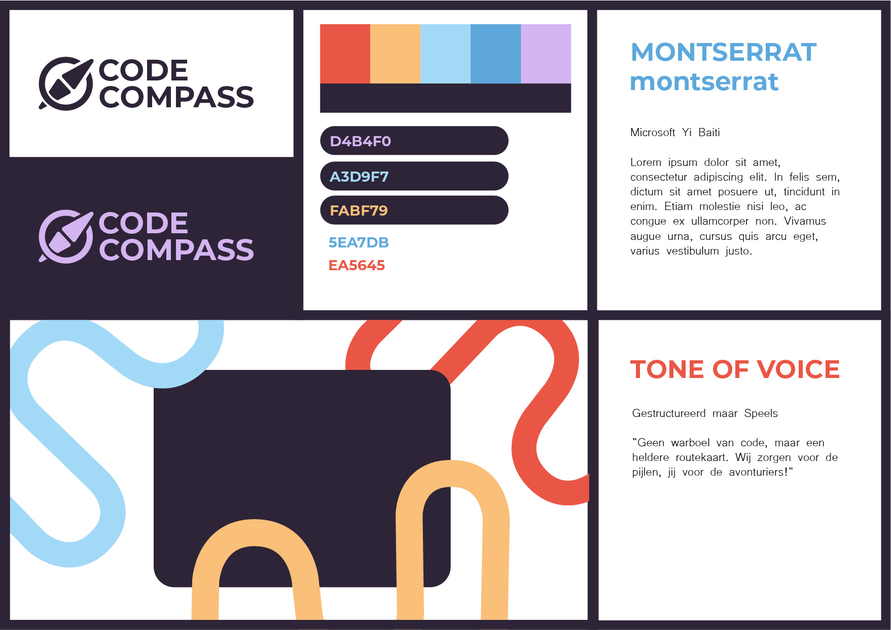

# Content Checklist — Make This Your Portfolio

This file guides you through what needs to be filled in with **your own words and real content**. The docent must see that YOU made this — not an AI. Be authentic!

---

## 🖼️ Images (Required)

### Portrait Photo
- [ ] **File:** `assets/images/portrait.jpg`
- **Size:** ~400×500px or similar (will be displayed at 3:4 aspect ratio)
- **What:** A professional portrait of yourself for the About page
- **Where it appears:** about.html, top section (left side of hero)

### Project Images
Currently all project pages use gradient placeholders. You'll add real images here:

- [ ] **Project 01** (Brand Identity) — `assets/images/project-01-*.jpg` (add as many as you want)
- [ ] **Project 02** (Editorial Design) — `assets/images/project-02-*.jpg`
- [ ] **Project 03** (Visual Campaign) — `assets/images/project-03-*.jpg`
- [ ] **Project 04** (Packaging Design) — `assets/images/project-04-*.jpg`

**How to add them:** Read CLAUDE.md section "Project Pages" for the HTML pattern. Replace `.pimg` gradient divs with `` tags.

### CV File
- [ ] **File:** `assets/files/louis-mullers-cv.pdf`
- **Size:** Standard PDF (A4, max ~5MB)
- **Where it appears:** Footer "Download CV" link (all 6 pages)

---

## ✍️ Text Content

### About Page Bio (about.html)

**Where:** In the hero section, replacing the placeholder quote and bio paragraphs.

#### Quote (Cormorant italic, big, emotional)
Replace this placeholder:
```html
<!-- CURRENT: -->
<p class="about-quote">Your big statement about who you are and what drives you.</p>
```

**Write your own statement.** Examples:
- "I create visual solutions that tell stories."
- "Design isn't about decoration — it's about clarity and impact."
- "Every project is a chance to solve a problem creatively."

**Keep it:** Short (1 sentence), personal, in your own voice. NOT generic.

#### Bio Paragraphs (left column, 2 paragraphs)
Replace this:
```html
<!-- CURRENT: -->
<p>First paragraph about your background, where you study, what inspires you.</p>
<p>Second paragraph about your interests, what you're passionate about, or where you want to grow.</p>
```

**Write 2 short paragraphs. Questions to answer:**
1. Where are you from? What's your background? (education, influences)
2. What excites you about design? Why did you choose CMD?
3. What kind of projects do you love working on?
4. What are you learning or exploring right now?

**Example:**
> *"I'm a graphic designer from the Netherlands studying Communication & Multimedia Design. I love the moment when a visual concept clicks — when simplicity and creativity meet to solve a real problem. Whether it's building a brand identity or designing a campaign, I approach every project as a chance to communicate something meaningful."*

> *"Right now I'm exploring the intersection of art direction and user experience. I'm inspired by clean typography, bold color stories, and designs that feel both intentional and human. Outside of design, I'm into [your interests], which often finds its way into my work."*

---

### About Page Details (about.html)

**Edit the 4 detail cells:**

1. **Based in:**
   - Current: "Netherlands" (or update if different)
   - Change if needed

2. **Education:**
   - Current: "Hogeschool Zuyd — Communication & Multimedia Design"
   - Probably correct; update graduation year if you know it

3. **Status:**
   - Shows a pulsing green dot + "Available for work"
   - Leave as-is (this is true for a student)

4. **Contact:**
   - Current: `mullerslouis2@gmail.com` (your email)
   - Double-check this is correct in the HTML

---

### About Page Skills Section (about.html)

#### "How I Think" (Left column)
**Main statement:** Replace this line:
```html
<p class="about-statement">Your big idea about how you approach design problems.</p>
```

**Write your personal design philosophy.** Examples:
- "I believe design is about clarity. Every element should earn its place."
- "I solve problems visually. Start with empathy, end with elegance."
- "Design is storytelling. Every project tells someone a story."

**Keep it:** 1 sentence, punchy, authentic.

#### Traits + Descriptions (4 traits)
Currently placeholder. Edit these in `about.html` to match reality:

```html
<div class="about-trait">
  <h4>Problem-solving</h4>
  <p>I start every project by asking: what's the real problem? Then I explore multiple angles before settling on a solution.</p>
</div>
<div class="about-trait">
  <h4>Storytelling</h4>
  <p>Every design choice should serve a story. Colors, typography, imagery — all work together to communicate something.</p>
</div>
<div class="about-trait">
  <h4>Craftsmanship</h4>
  <p>Details matter. I obsess over spacing, contrast, alignment. The difference between good and great is often hidden in the details.</p>
</div>
<div class="about-trait">
  <h4>Collaboration</h4>
  <p>My best work happens when I'm working with others. I listen, I iterate, I stay open to feedback.</p>
</div>
```

**Replace the descriptions with your own.** What 4 traits define HOW YOU WORK?

#### "How I Work" (Right column)
**Proficiency bars** — Already set to:
- Illustrator: 90% (Fluent)
- Figma: 86% (Fluent)
- InDesign: 62% (Proficient)
- Photoshop: 58% (Proficient)
- Blender: 44% (Learning)

**Adjust if different.** If you're stronger/weaker in a tool, update the percentages in `style.css`:
```css
/* Find in style.css and update the width values */
.about-skill-bar-illustrator { width: 90%; }  /* Change 90% to your level */
```

---

### Project Pages (project.html, project-02.html, project-03.html, project-04.html)

Each project has multiple fields. Edit all of them with YOUR real project info.

#### Example: Project 01 (Brand Identity)

**File:** `project.html`

Replace the placeholders:

```html
<!-- EYEBROW (metadata) -->
<p class="project-eyebrow">01 Branding · 2024</p>
<!-- Update year if different -->

<!-- TITLE (staggered) -->
<h1 class="project-title">
  <span class="project-title-line">Brand</span>
  <span class="project-title-line project-title-indent">Identity</span>
</h1>
<!-- Change "Brand / Identity" to your real project name -->

<!-- META ROW -->
<div class="project-meta-row">
  <div class="project-meta-item">
    <span class="project-meta-label">Year</span>
    <span class="project-meta-value">2024</span>
  </div>
  <div class="project-meta-item">
    <span class="project-meta-label">Role</span>
    <span class="project-meta-value">Design · Art Direction</span>
  </div>
  <div class="project-meta-item">
    <span class="project-meta-label">Type</span>
    <span class="project-meta-value">Brand Identity</span>
  </div>
  <div class="project-meta-item">
    <span class="project-meta-label">Tools</span>
    <span class="project-meta-value">Illustrator · Figma</span>
  </div>
</div>

<!-- HERO IMAGE -->


<!-- OVERVIEW -->
<div class="project-overview">
  <div>
    <p>Describe the project in 2-3 sentences. What was the challenge? What did you create?</p>
  </div>
  <div>
    <ul class="project-deliverables">
      <li>Logo design</li>
      <li>Brand guidelines</li>
      <li>Visual identity</li>
      <!-- Add your real deliverables -->
    </ul>
  </div>
</div>
```

**For each project (01, 02, 03, 04):**

| Field | Example |
|-------|---------|
| Eyebrow | "01 Branding · 2024" |
| Title line 1 | "Brand" |
| Title line 2 | "Identity" |
| Year | 2024 (or whenever) |
| Role | "Design · Art Direction" (what did YOU do?) |
| Type | "Brand Identity", "Editorial Design", etc. |
| Tools | "Illustrator · Figma" (what software?) |
| Overview text | 2-3 sentences about the project |
| Deliverables | 4-5 items (logo, guidelines, posters, etc.) |

---

## 🎬 Project Titles & Descriptions

The 4 projects are currently:
1. **Project 01** — Brand Identity
2. **Project 02** — Editorial Design
3. **Project 03** — Visual Campaign
4. **Project 04** — Packaging Design

**Update these IF you have different real projects.** Otherwise, create 4 projects that match these categories.

For each project, write:
- [ ] Real project name
- [ ] Year completed
- [ ] Your role (designer, art director, etc.)
- [ ] Type/category
- [ ] 2-3 sentence description of the challenge and solution
- [ ] 4-5 deliverables (what you created)
- [ ] 3-5 images showing the work

---

## 📱 Homepage (index.html)

The homepage is mostly built. You might want to customize:

- [ ] Hero taglines — Are these still correct?
  ```html
  <!-- Current: -->
  <p class="hero-tagline">Think clearly.</p>
  <p class="hero-tagline">Design boldly.</p>
  <p class="hero-tagline">Visual Design student — Belgium — available for work</p>
  ```
  Update if you want different taglines.

- [ ] Works section — The 4 project items link to your project pages. No text editing needed here, but make sure images are added to each project.

---

## 📋 Checklist Summary

### Before showing your docent:

- [ ] Uploaded portrait.jpg
- [ ] Uploaded louis-mullers-cv.pdf
- [ ] Filled in About page: quote, bio (2 paragraphs), traits
- [ ] Updated all 4 project pages with real titles, metadata, descriptions
- [ ] Added project images to all galleries
- [ ] Checked all text is YOUR OWN WORDS (not AI-sounding)
- [ ] Tested on desktop AND mobile (Chrome DevTools)
- [ ] No console errors (F12 → Console tab)
- [ ] All internal links work (click around all pages)
- [ ] All external links work (LinkedIn, Instagram, CV download)

### Optional (if you want to impress):

- [ ] Add Open Graph meta tags for social sharing
- [ ] Improve mobile responsiveness (Haiku model can help quickly)
- [ ] Add more projects or case studies
- [ ] Create a blog or insights section

---

## ⚡ Quick Tips

1. **Keep it authentic** — Your docent will know if the text doesn't sound like you.
2. **Be specific** — "I designed a brand identity for a local coffee shop" beats "I made a design."
3. **Show your work** — Images > text. Add lots of project screenshots.
4. **Mobile test** — Open Chrome DevTools (F12) and toggle device toolbar (Ctrl+Shift+M). Test on 390px width.
5. **Git commits** — After each big change, do `git add . && git commit -m "Update project descriptions"`.

---

**When you're done editing, open index.html with Live Server and test everything. Then you're ready to show your docent!**
